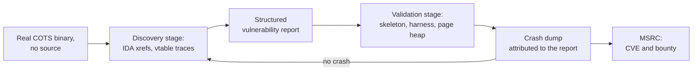

# The agentic finders: the automation tier

> This series has profiled the market's human tiers: the grudge individual, the state
> program, the seller, the recycler, the contractor, the broker. In 2026 a new tier
> cleared MSRC's gate. A university lab's agent harness found 39 zero-days across COM/RPC
> services and kernel drivers, collected 23 CVEs and a reported 203,000 USD in bounties,
> and every one of its findings was validated by a crash dump before a human ever saw it.
> The interesting part is not the model. It is the tools the model was given.

!!! note "Verdict basis"
    `cited`, as of 2026-11-02, to the SLYP paper (arXiv:2605.05000, May 2026), the
    blindCyber writeup (February 2026), and the MSRC bounty record as those authors
    report it. All counts are the authors' own claims, cross-confirmed by MSRC where the
    paper says so; nothing here is independently reproduced.

## Who

Two data points define the tier so far. The anchor is SLYP, built by Hwiwon Lee, Jongseong
Kim and Lingming Zhang's software-engineering group at UIUC, whose lineage is testing and
program analysis rather than exploit development. The second is a solo researcher writing
as blindCyber, who aimed an agent at SYSTEM-hosted COM services and walked away with
CVE-2026-21223 and 20,000 USD in about a month. Neither is an exploit developer in the
sense the rest of this series uses the word. Both built finding machinery, and the
machinery worked at market rates.

## The signature: tools over scaffold

SLYP is a standard ReAct loop in two stages, discovery then validation, connected by a
structured vulnerability report. What makes it work is everything around the loop:

- **Three MCP tool servers, 33 tools total.** Binary exploration (9 tools driving
  IDA Pro and Hex-Rays over RPC, with virtual-call resolution annotated straight into the
  pseudocode), a COM target adapter (14 tools built on OleViewDotNet, which is
  [Forshaw's](james-forshaw.md) own tooling), and dynamic debugging (10 tools driving
  WinDbg through a named pipe).
- **A live target.** A QEMU Windows 11 VM with page heap enabled and per-case snapshots,
  so every hypothesis can be executed, not argued.
- **Middleware that refuses hollow exits.** Auto-compaction with structured checkpoints,
  BM25-retrieved file memory for long sessions, and a verifier that rejects premature
  termination or plan-only answers.

The ablations in the paper say the quiet part plainly: the scaffold is replaceable and the
tools are not. Execution feedback is the minimum requirement for validation, and model
quality matters most in the validation stage, the long-horizon debugging loop, not in
discovery.

## The benchmark discipline

The part exploit developers should study is the ground truth. The benchmark is not seeded:
20 production COM objects across 10 services, every object an authenticated user can
activate, 379 entry functions, of which 64 are genuinely vulnerable, nearly all
use-after-free and double-free [race conditions](../vuln-classes/race-conditions.md) of
the COM reference-counting flavor. Every candidate was manually confirmed with a crashing
proof of concept, then confirmed again by MSRC. Twelve of the twenty objects carried
zero-days found during the study itself.

## What the numbers say

On those 64 vulnerable entry functions: SLYP found 64 of 64 with two false positives, on
both GPT-5.4 and Opus 4.6. Default Codex found 61, default Claude Code 49, both with
multiples of the false positives. On validation, the gap becomes structural: SLYP
verified 23 to 27 of the 40 vulnerability cases; the production agents verified zero of
40, because they had no way to activate a COM class and watch it crash. Give them SLYP's
tool servers and they recover most of the discovery gap and part of the validation gap.
Even the weakest model in the study found 42 functions. The dedicated static analyzer
(COMRace++), the pre-agentic state of the art for this bug class, peaked at 35 of 64 with
216 false positives. The harness, not the model, is the finding capacity.

## The kernel yield

The same harness, prompt changes only, was pointed at kernel drivers and found 8
zero-days across `win32k.sys`, `ntoskrnl.exe`, `afd.sys` and `Http.sys`: three
use-after-free, three out-of-bounds, two overflows, including a sandbox-to-system bug.
That is the surfaces the [finder](j00ru-win32k-decade.md) tier mapped by hand over a
decade, swept by a lab in one study. `afd.sys` is already a corpus subject: see the
[CVE-2023-21768 case study](../case-studies/CVE-2023-21768.md) for what an AFD
write-what-where buys.

## Composition, or: the tiers meet

The automation tier does not invent its own vocabulary; it composes the existing one, the
same way every other tier in this series does. SLYP's target adapter is
OleViewDotNet underneath, so the machine walks COM with the primitives librarian's map
in hand. blindCyber's agent bulk-enumerated SYSTEM-hosted COM services by privilege and
security descriptor, thousands of classes down to roughly 50 targets, and the winner was
`IElevatorEdge`: a standard user calling `LaunchUpdateCmdElevatedAndWait` with the
`edge-vbs-disable` command id, SYSTEM running setup.exe, VBS off, Credential Guard and
HVCI dead. One month from report to CVE. Meanwhile the human answer on the same surface
arrived the same autumn: Forshaw's dangling-registration sweep, a named primitive plus a
public finder script, is the same shape of work with a human holding the pen.

## What it defeats, and what stops it

What the tier produces is exactly what its oracle can verify: memory-safety bugs that
crash under page heap, which is why the yield is [use-after-free](../vuln-classes/use-after-free.md)
races and pool corruptions, crossing Low to Medium and Medium to SYSTEM service
boundaries and, in the kernel set, sandbox to system. What stops it is everything without
that oracle. The DosDevices ownership bug in the Administrator Protection work, five
correct behaviors composing into an escalation, has no crash dump; nothing in the SLYP
results suggests the harness would find it. Logic bugs, boundary-design failures and
consent-model flaws remain the human tier's home field, and the false-positive rates on
weaker models are a reminder that discovery without validation is a rumor generator.

## Assessment

Every prior tier in this series converts some scarce input into working escalations:
skill, patience, stolen code, money. This one converts compute, and its marginal cost per
finding falls while every human tier's rises. For the exploit economy, it shortens the
shelf life of every memory-safety bug class with a checker or a crash oracle, beginning
with the COM races SLYP just harvested. For defenders, the same fact reads as acceleration
of the fix pipeline: 39 bugs went to MSRC, not to a broker. For this corpus, it is a
dating problem: `asOf` verdicts on anything with a crash oracle will churn faster now,
and the reference should say so rather than pretend the finding rate of 2025 still holds.

## Sources

Hwiwon Lee, Jongseong Kim and Lingming Zhang, "Slyp: Agentic Vulnerability Reasoning on
COTS Binaries" (arXiv:2605.05000, May 2026): benchmark construction, agent architecture,
ablations, and the 39-zero-day yield (31 COM/RPC service bugs, 8 kernel driver bugs,
23 CVEs, a reported 203,000 USD in MSRC bounties). blindCyber, "Agentic 0day Research:
Edge VBS Bypass" (February 2026): CVE-2026-21223, `IElevatorEdge` and the
`edge-vbs-disable` command id, 20,000 USD, one month report to CVE. James Forshaw,
Project Zero (2026-09-21), "Windows Exploitation Techniques: Dangling COM Object
Registrations": the human-tier counterpart on the same COM surface.
